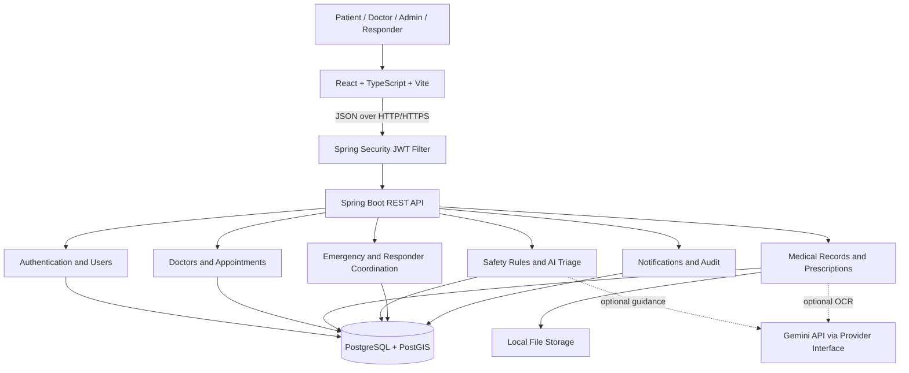

::: {align="center"}
# CURA

### Connected Healthcare. Responsible AI. Coordinated Emergency Support.

**An AI-assisted digital health platform for telehealth, clinical
triage, electronic medical records, prescription processing, and
emergency first-responder coordination.**

:::\(!IMPORTANT\) Educational prototype only. CURA is a B.Tech CSE
capstone project. It is designed to use synthetic patient data and
simulated external integrations. It is not a validated clinical
system and must not be used for real patient care. AI-generated
guidance is not a medical diagnosis, and the prototype must not be
represented as contacting real emergency services unless an
authorized, verified integration is actually in place.

Table of Contents
- Overview
- Problem and Vision
- Core Modules
- User Roles
- Technology Stack
- Architecture
- How a Request Flows
- Data Model
- API Overview
- Getting Started
- Configuration
- Development Workflow
- Testing Strategy
- Security and Safety
- Project Status and Roadmap
- Repository Documentation
- Contributing
- Team and Acknowledgements
- License
Overview
CURA is an interoperable digital health platform that brings several
healthcare workflows into one modular application. It combines doctor
discovery and appointments, telehealth, electronic medical records
(EMR), prescription OCR, medication reminders, AI-assisted symptom
triage, and emergency responder coordination.

The project is being developed as a capstone with two goals:
1. Build a demonstrable full-stack application using a maintainable
   architecture.
2. apply AI responsibly while learning and documenting the engineering
   decisions behind the system.
CURA is designed as a modular monolith: one deployable Spring Boot
backend organized into distinct domain modules, with a React single-page
application and PostgreSQL as the primary data store. This keeps module
boundaries clear without introducing the operational overhead of
microservices prematurely.
Problem and Vision
Healthcare workflows can be fragmented across appointments, clinical
records, prescriptions, symptom assessment, and emergency coordination.
CURA explores how these workflows could be connected through a single
application with role-aware access and clearly defined data flows.

The intended experience is to help users:
- Discover doctors and manage appointments.
- Access authorized medical records and supporting documents.
- Digitize prescription information while keeping human verification
  in the loop.
- Receive structured, safety-first symptom triage guidance.
- Demonstrate an emergency SOS and responder-coordination workflow in
  a controlled simulation.
CURA is an educational engineering prototype, not a claim of clinical
effectiveness or production readiness.
Core Modules
  Module                  Intended capabilities   Notes
  Doctor discovery and    Search and filter       Booking consistency is
  appointments            doctors, view           supported by a unique
                          availability, book or   appointment slot
                          cancel slots, prevent   constraint in the
                          double-booking          proposed schema.

  Telehealth              Video consultation      WebRTC is planned for a
                          appointments            later milestone.

  Electronic medical      Create clinical         Uses patient/doctor
  records                 records, upload lab     relationships and
                          reports and imaging,    attachment metadata.
                          retrieve records with
                          access controls         

  Prescription processing Upload prescription     OCR output requires
                          images, extract         appropriate human
                          structured medicine     review.
                          details, flag
                          uncertainty, verify
                          extracted items         

  Generic medicine        Map brand names to      Matching must not
  comparison              generic alternatives    silently substitute or
                          for cost transparency   modify a prescription.

  Medication reminders    Manage scheduled        Notification delivery
                          reminders linked to     is initially designed
                          prescription items      to be mocked/simulated.

  Symptom intake and      Collect structured      Red-flag escalation
  triage                  symptoms, apply         takes precedence over
                          deterministic red-flag  AI-generated guidance.
                          rules, optionally
                          request AI guidance     

  Emergency SOS and       Record SOS requests,    Emergency dispatch and
  responder coordination  find nearby available   external notifications
                          responders, manage      are simulated by
                          assignments and         default.
                          location updates        

  Administration and      Manage users and        Access is controlled by
  auditing                hospitals, review audit user roles and
                      logs, record consent    ownership checks.
User Roles
  Role                                Intended permissions
  PATIENT                           Manage appointments, view their own
                                      records and prescriptions, submit
                                      symptom intake, manage reminders,
                                      and trigger simulated SOS requests.

  DOCTOR                            Manage availability, view records
                                      for authorized cases, create
                                      clinical notes, and verify
                                      prescription extraction.

  ADMIN                             Manage users and hospitals, review
                                      audit logs, and oversee
                                      administrative workflows.

  RESPONDER                         Update availability and location,
                                      view assigned emergency requests,
                                  and update assignment status.
Role checks alone are not sufficient for sensitive data: the application
must also enforce ownership and case-level access rules.
Technology Stack
  Layer                   Technology              Purpose
  Frontend                React 18, TypeScript,   Single-page web
                          Vite                    application

  Styling and UI          Tailwind CSS            Responsive interface
                                                  and reusable styling

  Frontend routing        React Router v6         Client-side navigation

  Frontend state          Zustand                 Lightweight shared
                                                  state, including
                                                  authentication state

  Backend                 Java 24, Spring Boot    REST API and modular
                          3.x                     business logic

  API security            Spring Security, JWT    Authentication and
                          access and refresh      role-based
                          tokens                  authorization

  Persistence             Spring Data JPA,        Relational persistence
                          Hibernate               

  Database                PostgreSQL 16           Primary application
                                                  data store

  Geospatial              PostGIS                 Location-aware hospital
                                                  and responder queries

  Schema migrations       Flyway                  Versioned database
                                                  schema changes

  API documentation       OpenAPI 3 / Swagger UI  API discovery and
                                                  testing

  AI integration          Google Gemini API       Optional OCR and triage
                          behind provider         guidance
                          interfaces              

  File storage            Local filesystem in     Prescription images and
                          development             medical attachments

  Build tools             Maven, npm / Vite       Backend and frontend
                                                  builds

  Containers              Docker, Docker Compose  Reproducible local
                                                  development

  Testing                 JUnit 5, Mockito,       Unit, integration, API,
                          MockMvc, Selenium       and browser testing
                          WebDriver               

  Future real-time        WebSockets, WebRTC      Live updates and video
  features                                        consultation;
                                              planned/deferred
Exact versions and implementation status should be confirmed against the
actual repository and build files. This table describes the intended
project stack, not proof that every component is already implemented.
Architecture
Architectural style: modular monolith
The backend is organized into domain modules inside one Spring Boot
application. Moving to microservices is deliberately deferred unless
there is a demonstrated need and explicit approval.

Backend module boundaries
Each module follows a consistent separation of responsibilities:
- Controller: accepts HTTP requests, validates inputs, delegates
  to services, and returns response DTOs.
- Service: owns business rules, coordinates repositories and
  providers, and manages transactions.
- Repository: encapsulates database access through Spring Data JPA
  and targeted queries.
- Entity: represents persisted data and is not returned directly
  from REST controllers.
- DTO: defines API request and response shapes independently of
  database entities.
- Provider interface: isolates external integrations so production
  and mock implementations can be swapped and tested.
Security request flow
Incoming request
    ↓
JWT authentication filter
    ↓
Spring Security filter chain
    ↓
Role checks at the API boundary
    ↓
Service-layer ownership and access checks
    ↓
Business logic and database operation
    ↓
Structured response or handled error
External integrations
AI, OCR, notifications, and future video functionality should be
accessed through provider interfaces. This keeps the core business logic
testable without requiring an external service for every test. Mock
implementations should be clearly identified and must never be presented
as real-world delivery.
How a Request Flows
For example, when a patient books an appointment:
1. The patient selects an available slot in the React frontend.
2. The frontend API client sends a request to the Spring Boot API with
   the required authentication.
3. The controller validates the request and delegates to the
   appointment service.
4. The service verifies the slot and applicable business rules.
5. The repository persists the appointment inside an appropriate
   transaction.
6. Database constraints help prevent conflicting bookings.
7. The API returns a structured response and the frontend updates its
   view.
The exact behavior must be verified against the implementation and
tests. The documented database design uses a unique constraint on
appointments.slot_id so that one availability slot can have at most
one appointment.
Data Model
The planned PostgreSQL schema uses BIGSERIAL primary keys,
timezone-aware TIMESTAMPTZ timestamps, explicit foreign keys, indexes
for common lookups, and Flyway migrations. PostGIS
GEOGRAPHY(POINT, 4326) fields are used for location-aware queries.
Main entities
  Domain                              Tables / entities
  Identity                            users, user_profiles,
                                      refresh_tokens

  Hospitals and doctors               hospitals, doctors

  Scheduling                          availability_slots,
                                      appointments

  Medical records                     medical_records,
                                      record_attachments

  Prescriptions                       prescriptions,
                                      prescription_items

  Reminders                           medication_reminders

  Triage                              triage_sessions

  Emergency coordination              emergency_requests, responders,
                                      responder_assignments
  Governance                          audit_logs, consent_records
Important data integrity decisions
- A unique appointments.slot_id prevents multiple appointments from
  referencing the same slot.
- Availability slots require end_time > start_time.
- Doctor profiles are linked one-to-one with user accounts.
- Emergency requests default to is_simulated = TRUE.
- Triage records carry a disclaimer that AI guidance is not a
  validated diagnosis.
- GIST indexes support proximity searches on PostGIS geography
  columns.
- Schema changes are intended to be managed through versioned Flyway
  migrations.
